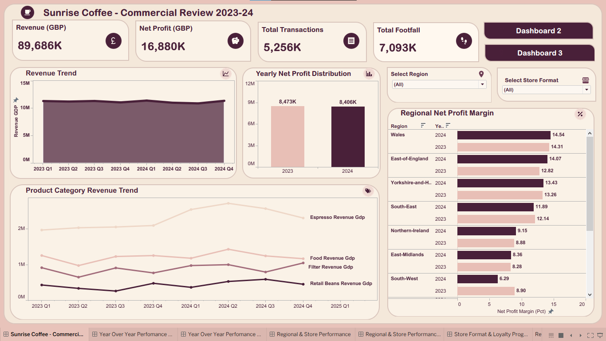
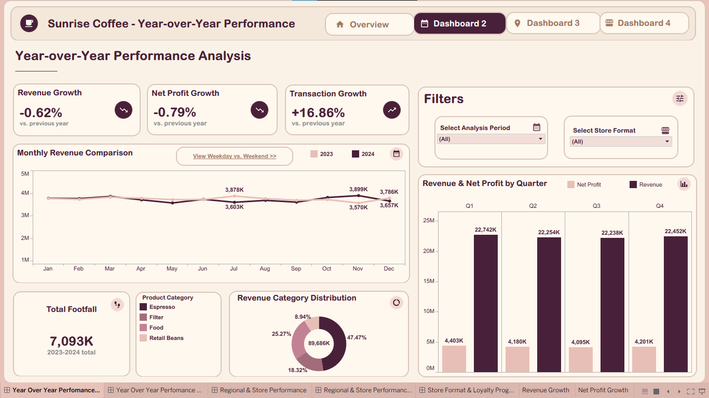
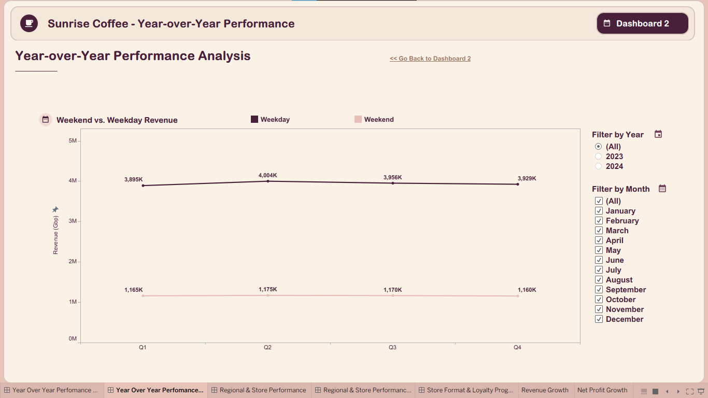
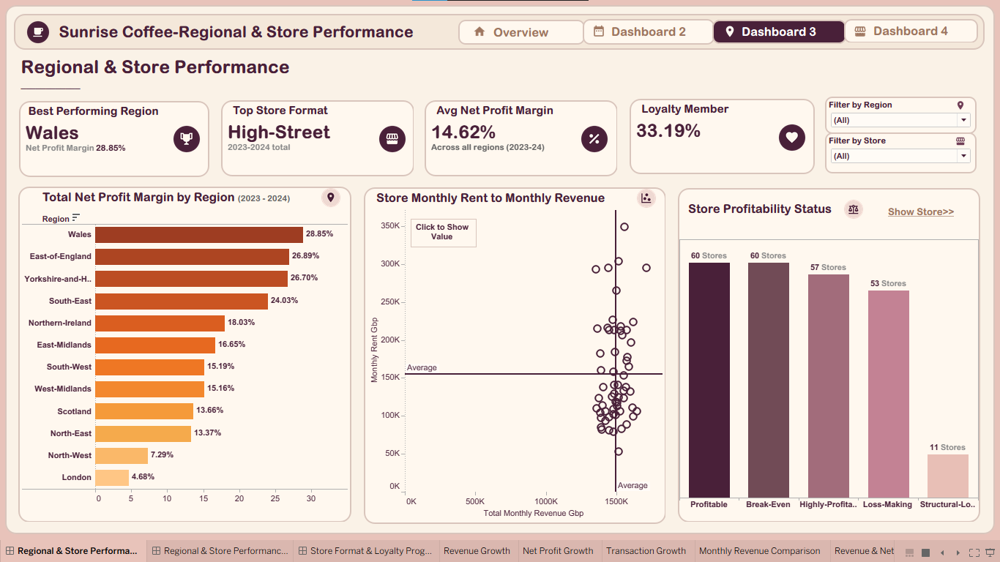
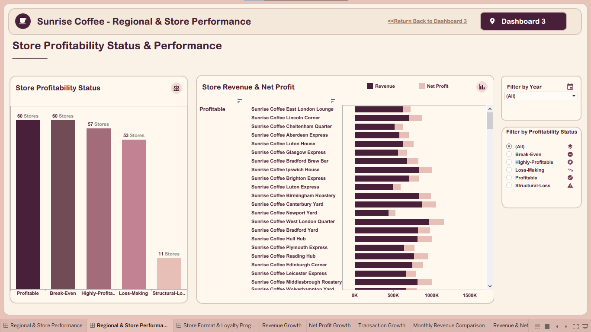
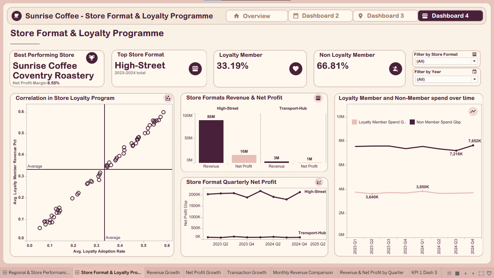
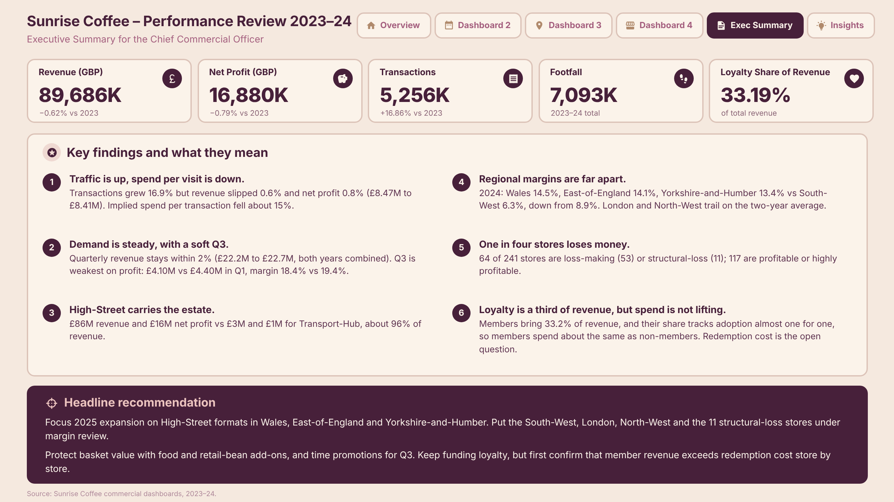
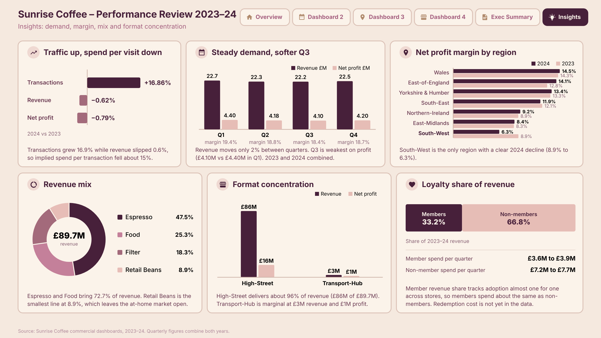

# Sunrise Coffee Chain Performance Analysis

### Commercial Performance | Business Intelligence | Tableau

## Project Overview

This project presents a comprehensive business performance analysis of Sunrise Coffee Chain, developed using Tableau as part of the October 2026 OnyxData DataDNA Challenge.

The analysis examines the company's financial performance, sales trends, regional profitability, store-level performance, product contribution, trading behaviour, and customer loyalty.

The objective is to translate business data into meaningful insights that support performance evaluation, identify commercial challenges, and inform strategic decision-making.

## Business Objectives

The analysis seeks to:

- Evaluate revenue, net profit, and transaction performance.
- Assess year-over-year business performance.
- Examine weekday and weekend trading patterns.
- Identify regional and store-level profitability differences.
- Evaluate the contribution of store formats and product categories.
- Understand customer loyalty programme performance.
- Identify opportunities to improve operational efficiency and profitability.

## Dashboard Showcase

### 1. Business Performance Overview

### 2. Year-over-Year Performance Analysis

### 3. Weekday vs Weekend Analysis

### 4. Regional and Store Performance

### 5. Additional Performance Analysis

### 6. Store Format and Loyalty Programme Analysis

### 7. Executive Summary

### 8. Business Insights and Recommendations

## Key Business Findings

| KPI | Performance |
|---|---:|
| Total Revenue | £89.69M |
| Net Profit | £16.88M |
| Revenue Change vs. 2023 | -0.62% |
| Net Profit Change vs. 2023 | -0.79% |
| Transaction Growth | +16.86% |
| Wales Net Margin | 14.54% |
| South-West Net Margin | 6.29% |
| Espresso Revenue Contribution | 47.47% |
| Food Revenue Contribution | 25.27% |
| Loyalty Member Revenue Share | 33.19% |

## Key Insights

**Financial Performance**

Revenue and net profit declined slightly compared with 2023, despite transaction growth. This highlights the importance of examining profitability alongside sales activity.

**Regional Performance**

Profitability varies across regions, indicating opportunities to investigate regional operating conditions and improve margins in weaker-performing areas.

**Product Contribution**

Espresso and Food account for a combined 72.74% of revenue, demonstrating their importance to the company's overall sales mix.

**Customer Loyalty**

Loyalty programme members contribute 33.19% of revenue, while non-members account for 66.81%. This presents an opportunity to strengthen customer engagement and programme participation.

**Store Performance**

Differences in store-level profitability highlight the need for targeted operational improvements rather than applying a uniform strategy across all locations.

## Business Recommendations

1. **Profitability Optimisation:** Investigate cost pressures and operational inefficiencies affecting net profit.
2. **Store Performance Management:** Prioritise underperforming locations for targeted operational and commercial reviews.
3. **Regional Improvement:** Investigate regional margin differences and identify opportunities to strengthen weaker markets.
4. **Product Mix Optimisation:** Protect high-contributing categories while identifying opportunities to improve the performance of other product lines.
5. **Customer Loyalty Growth:** Develop targeted initiatives to increase loyalty programme participation and customer retention.
6. **Demand-Based Operations:** Use weekday and weekend trading patterns to improve staffing, inventory planning, and resource allocation.

## Tools & Technologies

- Tableau — Data visualisation and interactive dashboard development.
- Microsoft Excel — Data preparation and analysis.
- Business Intelligence — KPI monitoring and performance reporting.
- Data Analytics — Exploratory analysis and business insight generation.

## Data Source & Acknowledgement

Developed as part of the October 2026 DataDNA Sunrise Coffee Chain Analytics Challenge by Onyx Data.

[View the Original Challenge](https://datadna.onyxdata.co.uk/challenges/october-2026-datadna-sunrise-coffee-chain-analytics-challenge/)

## Conclusion

This project demonstrates how financial, operational, geographical, and customer data can be integrated to develop a more comprehensive understanding of business performance.

Through interactive Tableau dashboards and focused commercial analysis, the project identifies performance patterns, highlights areas requiring management attention, and translates analytical findings into actionable business recommendations.

---

**Project:** Sunrise Coffee Chain Performance Analysis  
**Platform:** Tableau  
**Analysis Period:** 2023–2024  
**Challenge:** OnyxData DataDNA — October 2026
